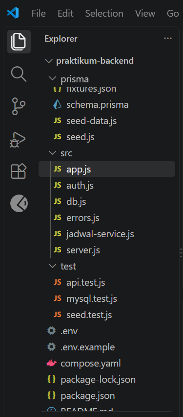
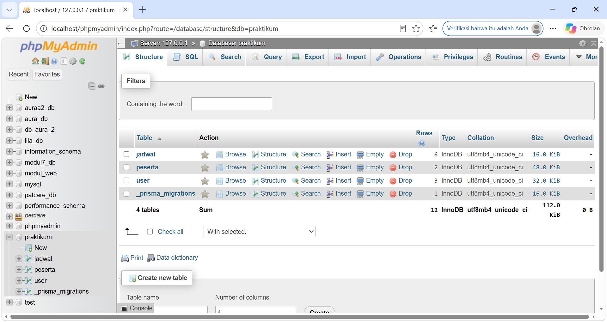
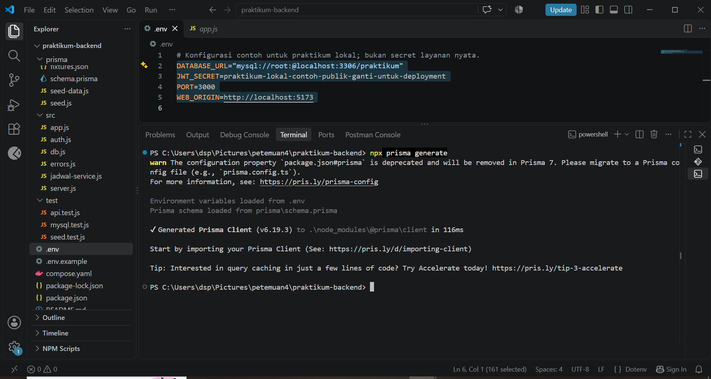
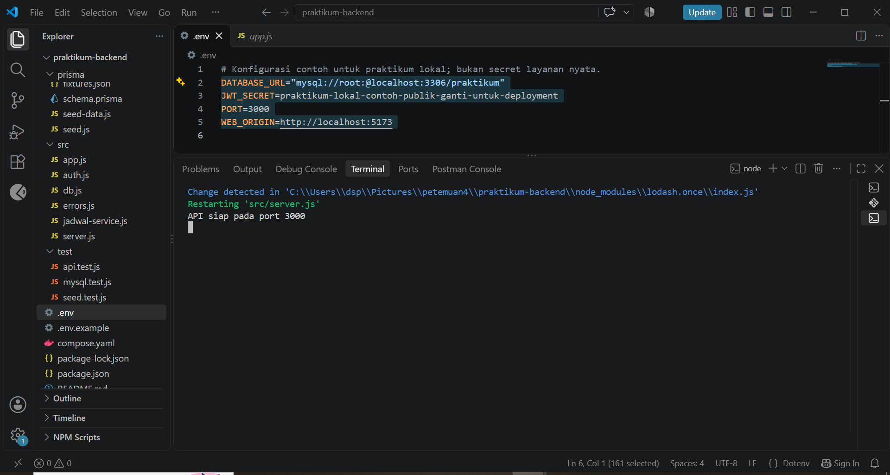
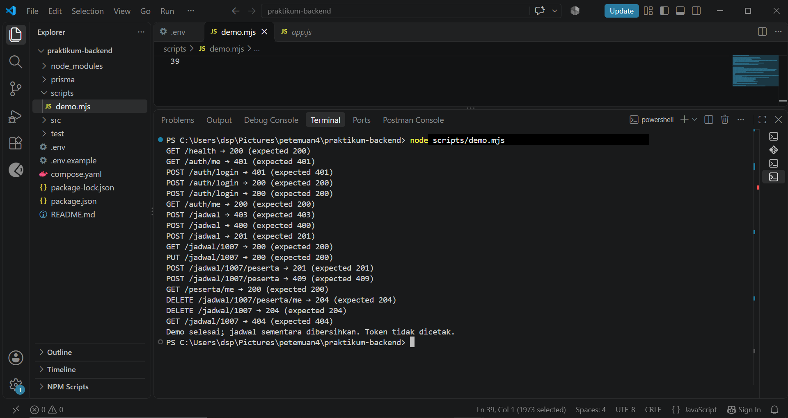
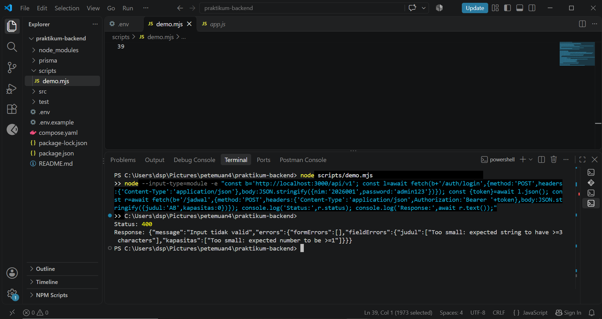
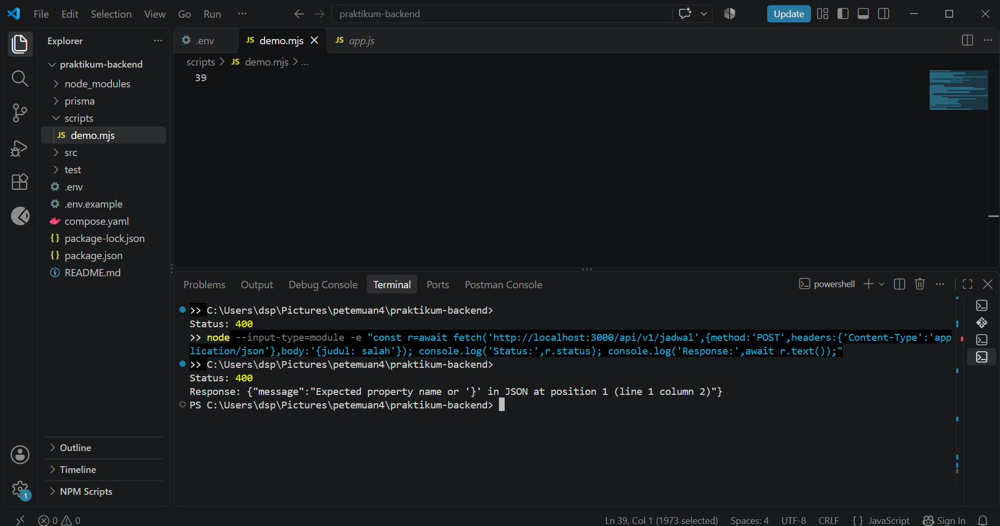
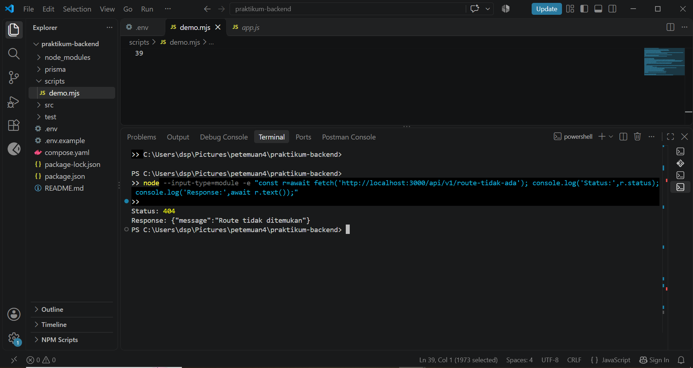
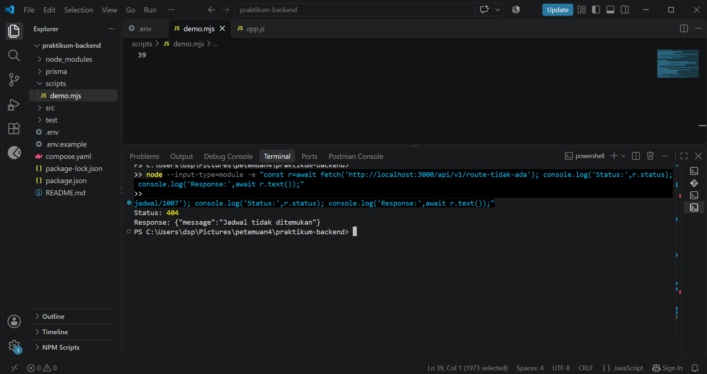

# LAPORAN PRAKTIKUM 05
## CRUD, VALIDASI & ERROR

### A. Tujuan Praktikum

Praktikum Pertemuan 5 bertujuan untuk memahami dan menerapkan operasi CRUD (Create, Read, Update, Delete) pada pengelolaan jadwal, melakukan validasi input menggunakan Zod, serta menangani kesalahan (error) agar respons API memiliki format dan status HTTP yang konsisten.

### B. Persiapan Praktikum

Perangkat dan teknologi yang digunakan:

1. Visual Studio Code
2. Node.js dan npm
3. MariaDB (XAMPP)
4. Prisma ORM
5. Express.js
6. Zod
7. Terminal PowerShell

### C. Struktur Folder

Struktur folder pengerjaan tugas individu:

```text
pertemuan-05/
├── laporan.md
└── bukti/
    ├── 01-struktur-backend.png
    ├── 02-database-aktif.png
    ├── 03-prisma-generate.png
    ├── 04-backend-aktif.png
    ├── 05-pengujian-crud-berhasil.png
    ├── 06-pengujian-validasi-gagal.png
    ├── 07-pengujian-json-rusak.png
    ├── 08-pengujian-route-404.png
    └── 09-pengujian-delete-database.png
```

### D. Implementasi Praktikum

Implementasi praktikum menggunakan backend yang sudah tersedia dari praktikum sebelumnya.

File utama yang dipelajari:

1. `praktikum-backend/src/app.js`

   Mengatur routing API, validasi input, autentikasi, otorisasi, serta operasi CRUD jadwal.

2. `praktikum-backend/src/errors.js`

   Menangani kesalahan yang terjadi selama proses request dan memberikan respons HTTP sesuai jenis kesalahannya.

**Dokumentasi struktur backend**



### E. Langkah Menjalankan Praktikum

1. Menjalankan database MariaDB melalui XAMPP dengan mengaktifkan MySQL pada XAMPP Control Panel.
2. Memastikan database praktikum sudah tersedia dan sudah dimigrasi.
3. Memastikan Prisma Client sudah tersedia.
4. Menjalankan backend pada port 3000.
5. Membuka terminal baru pada folder `praktikum-backend` yang memuat `package.json`.
6. Menjalankan perintah:

```bash
node scripts/demo.mjs
```

**1. Database berhasil dijalankan**



**2. Prisma Client berhasil di-generate**



**3. Backend berhasil dijalankan pada port 3000**



### F. Hasil Pengujian

**1. Pengujian CRUD Berhasil**

Pengujian dilakukan menggunakan script `demo.mjs` untuk memastikan seluruh proses pada backend berjalan sesuai dengan status HTTP yang diharapkan. Pengujian meliputi health check, login, autentikasi, otorisasi, tambah jadwal, baca jadwal, ubah jadwal, pendaftaran peserta, penghapusan data, serta penanganan kondisi ketika data tidak ditemukan. Berdasarkan hasil pengujian, seluruh 17 skenario berhasil memperoleh status HTTP sesuai dengan yang diharapkan.

| No. | Pengujian | Status Diharapkan | Hasil Aktual |
|---|---|---|---|
| 1 | Health check | 200 | 200 (Berhasil) |
| 2 | Akses `/auth/me` tanpa login | 401 | 401 (Berhasil) |
| 3 | Login dengan password salah | 401 | 401 (Berhasil) |
| 4 | Login admin | 200 | 200 (Berhasil) |
| 5 | Login mahasiswa | 200 | 200 (Berhasil) |
| 6 | Akses `/auth/me` dengan token | 200 | 200 (Berhasil) |
| 7 | Mahasiswa mencoba membuat jadwal | 403 | 403 (Berhasil) |
| 8 | Membuat jadwal dengan kapasitas tidak valid | 400 | 400 (Berhasil) |
| 9 | Create jadwal | 201 | 201 (Berhasil) |
| 10 | Read detail jadwal | 200 | 200 (Berhasil) |
| 11 | Update jadwal | 200 | 200 (Berhasil) |
| 12 | Mendaftarkan peserta | 201 | 201 (Berhasil) |
| 13 | Mendaftarkan peserta duplikat | 409 | 409 (Berhasil) |
| 14 | Melihat daftar peserta sendiri | 200 | 200 (Berhasil) |
| 15 | Menghapus keikutsertaan peserta | 204 | 204 (Berhasil) |
| 16 | Delete jadwal | 204 | 204 (Berhasil) |
| 17 | Read setelah delete | 404 | 404 (Berhasil) |

**Dokumentasi pengujian CRUD**



**2. Pengujian Validasi Input Gagal**

Pengujian dilakukan dengan mengirimkan data jadwal yang tidak memenuhi aturan validasi, yaitu:

- Judul kurang dari 3 karakter, menggunakan input `AB`.
- Kapasitas bernilai 0.

Hasil pengujian menunjukkan bahwa backend menolak data tersebut dan mengembalikan status HTTP 400 (Bad Request) dengan pesan "Input tidak valid". Hal ini menunjukkan bahwa validasi menggunakan Zod berhasil memeriksa input sebelum data disimpan ke database.

**Dokumentasi pengujian validasi gagal**



**3. Pengujian JSON Rusak**

Pengujian dilakukan dengan mengirimkan request menggunakan format JSON yang tidak valid. Hasil yang diharapkan adalah status 400.

**Dokumentasi pengujian JSON rusak**



**4. Pengujian Route Tidak Ditemukan**

Pengujian dilakukan dengan mengakses method atau path yang tidak terdaftar pada API. Hasil yang diharapkan adalah status 404.

**Dokumentasi pengujian route 404**



**5. Pengujian Data Setelah DELETE**

Pengujian dilakukan dengan mengakses kembali data jadwal menggunakan ID `1007` setelah proses penghapusan berhasil dilakukan. Hasil pengujian menunjukkan bahwa backend mengembalikan status HTTP 404 dengan pesan "Jadwal tidak ditemukan". Hal ini menunjukkan bahwa data jadwal tersebut sudah tidak dapat ditemukan melalui API setelah proses DELETE berhasil dijalankan.

**Dokumentasi pemeriksaan database**



### G. Pertanyaan Penjelasan Kode

**1. Dari mana input fitur ini berasal, dan di file mana input tersebut diperiksa?**

Input fitur berasal dari request yang dikirim oleh client melalui body, parameter URL, dan query URL. Input tersebut diperiksa pada file `backend/src/app.js` menggunakan skema validasi Zod, seperti `jadwalSchema`, `idSchema`, dan `querySchema`.

**2. Fungsi mana yang mengubah data atau state, dan kapan respons ditampilkan kepada pengguna?**

Fungsi yang mengubah data adalah `db.jadwal.create()` untuk menambahkan jadwal, `ubahJadwal()` untuk memperbarui jadwal, dan `db.jadwal.delete()` untuk menghapus jadwal.

Respons ditampilkan kepada pengguna setelah operasi database berhasil dijalankan. Jika terjadi kesalahan, error diteruskan ke `errorHandler` untuk menghasilkan respons yang sesuai.

**3. Apa yang terjadi jika request gagal pada titik sebelum penyimpanan dan sesudah penyimpanan? Gunakan satu fungsi konkret dari source di atas.**

Contohnya pada fungsi POST `/jadwal`.

Jika request gagal sebelum proses `db.jadwal.create()` berhasil dijalankan, data belum tersimpan ke database. Misalnya, input kapasitas tidak memenuhi aturan validasi Zod.

Namun, jika proses `db.jadwal.create()` sudah berhasil menyimpan data tetapi terjadi kegagalan ketika respons dikirim kepada client, data kemungkinan sudah tersimpan meskipun client menerima respons gagal. Oleh karena itu, perlu dilakukan pemeriksaan database untuk memastikan apakah data sudah tersimpan atau belum.

### H. Kesimpulan

Berdasarkan praktikum Pertemuan 5, dapat dipahami bahwa operasi CRUD digunakan untuk mengelola data jadwal melalui API. Validasi input menggunakan Zod membantu memastikan data yang diterima sesuai dengan aturan yang telah ditentukan.

Selain itu, penanganan error melalui `errorHandler` membuat respons API lebih konsisten dan memudahkan proses pengujian ketika terjadi kesalahan. Dengan demikian, implementasi CRUD, validasi, dan error handling dapat membantu meningkatkan keandalan backend.
